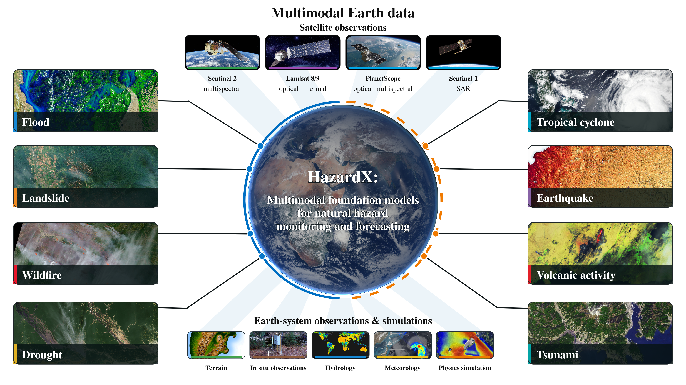
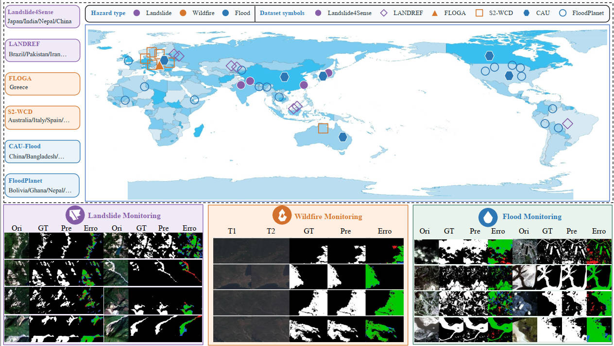
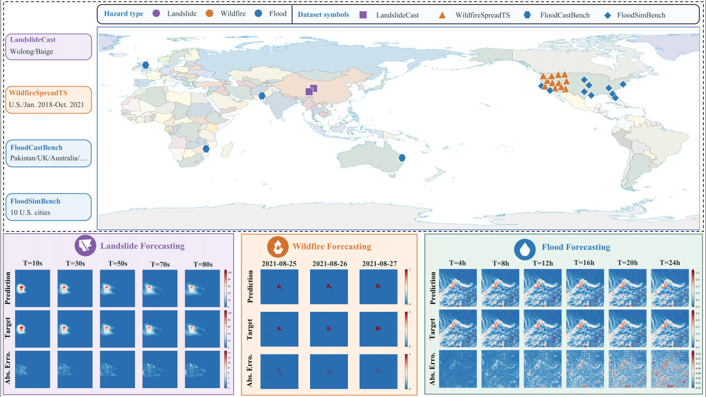
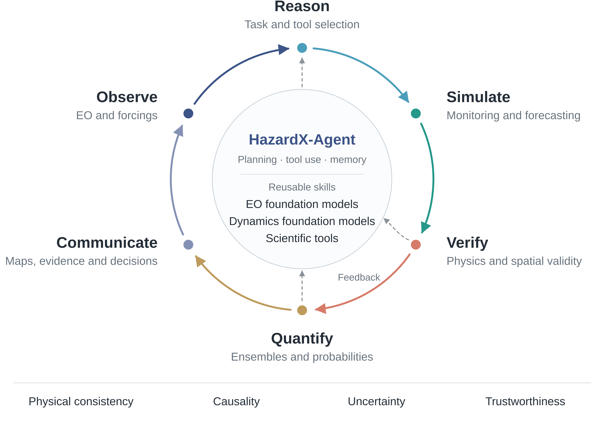

<p align="center">
  
</p>


# Overview
<p align="center">
  
</p>

**HazardX** is an open community framework for multimodal foundation models in natural hazard monitoring and forecasting. It integrates task formulations for monitoring (**HazardX-Monitoring**) and forecasting (**HazardX-Forecasting**), a shared experimental benchmark (**HazardX-Bench**), and a perspective on agentic hazard intelligence (**HazardX-Agent**).
HazardX focuses on floods, landslides, and wildfires, while the other hazards illustrate potential future extensions.


# HazardX-Bench for natural hazard monitoring

<p align="center">
  
</p>

The currently released monitoring implementation is located in [`HazardX-Bench/Monitoringcode/`](HazardX-Bench/Monitoringcode/).

## 🛠️ Installation

```bash
git clone https://github.com/HydroPML/HazardX.git
cd HazardX/HazardX-Bench/Monitoringcode
# Choose a PyTorch build matching your hardware and CUDA environment (cu126 is only an example).
pip install torch torchvision xformers --index-url https://download.pytorch.org/whl/cu126
# Install the additional dependencies required by your chosen model.
```

Some models require optional extras. For ChangeMamba's selective scan kernel:

```bash
# If you encounter GCC issues, consider: conda install -c conda-forge gcc=13 gxx=13 -y
cd src/models/ChangeMamba/kernels/selective_scan
pip install . --no-build-isolation
cd ../../../..
```

Some models also require local upstream weights in `pretrained_weight/` (details below).

## 🧪 Dataset Preparation

Dataset preparation guides are organized by disaster domain:

- Flood: [scripts/data_prep/flood/README.md](HazardX-Bench/Monitoringcode/scripts/data_prep/flood/README.md)
- Landslide: [scripts/data_prep/landslide/README.md](HazardX-Bench/Monitoringcode/scripts/data_prep/landslide/README.md)
- Wildfire: [scripts/data_prep/wildfire/README.md](HazardX-Bench/Monitoringcode/scripts/data_prep/wildfire/README.md)

## 📦 Pretrained Weights

Create the local weights directory inside `HazardX-Bench/Monitoringcode/`:

```bash
mkdir -p pretrained_weight
```

### 📥 Direct Downloads

```bash
# pretrain-vit-base-e199.pth
wget -O pretrained_weight/pretrain-vit-base-e199.pth \
  https://zenodo.org/records/7338613/files/pretrain-vit-base-e199.pth

# SpectralGPT+.pth
wget -O "pretrained_weight/SpectralGPT+.pth" \
  "https://zenodo.org/records/8412455/files/SpectralGPT+.pth?download=1"

# spec-vit-base-ultra-checkpoint-1599.pth
wget -O pretrained_weight/spec-vit-base-ultra-checkpoint-1599.pth \
  https://huggingface.co/WHU-Sigma/HyperSIGMA/resolve/main/spec-vit-base-ultra-checkpoint-1599.pth

huggingface-cli download UTokyo-Yokoya-Lab/AnyDisaster-Pretrained_Weight \
  vssm_tiny_0230_ckpt_epoch_262.pth --local-dir pretrained_weight
```

### 🧩 Additional Upstream Checkpoints

- **DINOv3:** https://ai.meta.com/resources/models-and-libraries/dinov3-downloads/
  - `dinov3_vitb16_pretrain_lvd1689m-73cec8be.pth` (ViT-B/16, LVD-1689M)
  - `dinov3_vitl16_pretrain_lvd1689m-8aa4cbdd.pth` (ViT-L/16, LVD-1689M)
  - `dinov3_vitl16_pretrain_sat493m-eadcf0ff.pth` (ViT-L/16, SAT-493M)
- **SAM 2.1:** https://github.com/facebookresearch/sam2
  - `sam2.1_hiera_small.pt`
  - `sam2.1_hiera_base_plus.pt`
- **SegFormer MiT:** https://github.com/NVlabs/SegFormer
  - `mit_b0.pth`, `mit_b1.pth`, `mit_b2.pth`, `mit_b3.pth`, `mit_b4.pth`, `mit_b5.pth`
- **SkySense++ backbone:** [repository](https://github.com/Jack-bo1220/SkySense) and [checkpoints](https://www.notion.so/SkySense-Checkpoints-a7fcff6ce29a4647a08c7fe416910509)
  - Select the `hr` (high-resolution RGB / RGBNIR) variant, not the `s2` Sentinel-2 variant.
  - Save as `skysense_model_backbone_hr.pth` (confirm the filename expected by the chosen config).
  - For commercial use, contact the authors (`yansheng.li@whu.edu.cn`).

Depending on the selected model, your `pretrained_weight/` directory may include:

```text
pretrained_weight/
├── clay-v1.5.ckpt
├── dinov3_vitb16_pretrain_lvd1689m-73cec8be.pth
├── dinov3_vitl16_pretrain_lvd1689m-8aa4cbdd.pth
├── dinov3_vitl16_pretrain_sat493m-eadcf0ff.pth
├── dofav2_vit_base_e150.pth
├── dofav2_vit_large_e150.pth
├── Galileo_nano_encoder.pt
├── Prithvi_EO_V2_300M/
├── TerraMind_v1_base/
├── HSI_spatial_checkpoint-1600.pth
├── mit_b0.pth
├── mit_b1.pth
├── mit_b2.pth
├── mit_b3.pth
├── mit_b4.pth
├── mit_b5.pth
├── pretrain-vit-base-e199.pth
├── sam2.1_hiera_base_plus.pt
├── sam2.1_hiera_small.pt
├── skysensepp_model_backbone_hr.pth
├── spec-vit-base-ultra-checkpoint-1599.pth
├── SpectralGPT+.pth
└── vssm_tiny_0230_ckpt_epoch_262.pth
```

For upstream checkpoints not directly linked above, consult the corresponding model's official repository or documentation. Comply with the license for each model and dataset.

## 🚀 Quick Start

From `HazardX-Bench/Monitoringcode/`, after preparing the dataset and any required weights:

### 🏋️ Train

```bash
python train.py --config config/flood/cau/seg_unet.yaml
```

### 📊 Evaluate

```bash
python test.py --exp_path results/flood/cau/seg_unet
```

## 🗂️ Repository Layout

```text
HazardX/
├── README.md
└── HazardX-Bench/
    └── Monitoringcode/
        ├── README.md
        ├── config/
        ├── docs/
        ├── scripts/data_prep/
        ├── src/core/
        ├── src/datasets/
        ├── src/models/
        ├── src/tasks/
        ├── train.py
        └── test.py
```

Within `Monitoringcode/`:

- `src/core/`: trainer, config loader, registry, augmentation and metrics
- `src/tasks/`: segmentation, change detection and semantic change detection task handlers
- `src/datasets/`: dataset adapters and runtime data contracts
- `src/models/`: model wrappers and third-party implementations
- `config/`: experiment configurations grouped by domain and dataset
- `scripts/data_prep/`: dataset preparation instructions and utilities
- `docs/`: architecture and extension guidance

## 🏗️ Architecture and Extension

- [Architecture overview](HazardX-Bench/Monitoringcode/docs/ARCHITECTURE.md)
- [Extension guide](HazardX-Bench/Monitoringcode/docs/EXTENSION_GUIDE.md)

# HazardX-Bench for natural hazard forecasting
<p align="center">
  
</p>

The forecasting implementation is located in [`HazardX-Bench/Forecastingcode/`](HazardX-Bench/Forecastingcode/).

This repository brings together **FloodCastBench, FloodSimBench, LandslideCast, and WildfireSpreadTS**, along with representative deep learning models for **flood, landslide, and wildfire forecasting**. It provides a unified training and evaluation interface for 36 selected experiments while preserving the original model implementations, configurations, and evaluation protocols.

## 🛠️ Installation

Requires Linux, Python 3.11, and a CUDA GPU. Validated with PyTorch 2.5.0, CUDA 12.4, and an RTX A6000.

From the repository root:

```bash
cd HazardX-Bench/Forecastingcode
python3.11 -m venv .venv
source .venv/bin/activate
pip install torch==2.5.0 torchvision==0.20.0 --index-url https://download.pytorch.org/whl/cu124
pip install -r requirements.txt
```

For PDE-Transformer, use a separate environment with the same PyTorch version and `requirements-pde.txt`. See [environment details](HazardX-Bench/Forecastingcode/docs/environments.md).

## 🧪 Dataset Preparation

Download datasets from their official sources:

| Dataset | Official source | Expected local input |
| --- | --- | --- |
| FloodCastBench | [Dataset](https://zenodo.org/records/14017092), [official code](https://github.com/HydroPML/FloodCastBench) | Existing split `.pt` trajectories and original DEM rasters |
| FloodSimBench | [Official dataset](https://huggingface.co/datasets/chrimerss/FloodSimBench) | Native 1 m water-depth and DEM GeoTIFFs |
| LandslideCast | [Official project](https://github.com/HydroPML/Landslidecast), [paper](https://doi.org/10.1029/2023EA003417) | Canonical `2d_t10.h5` with scenarios `x1` through `x12000` |
| WildfireSpreadTS | [Official dataset](https://zenodo.org/records/8006177), [official code](https://github.com/SebastianGer/WildfireSpreadTS) | Official daily TIFFs or the original lossless HDF5 conversion |


| Dataset | Physical model input (excluding batch and positional encodings) | Prediction protocol |
| --- | --- | --- |
| FloodCastBench | `1 × 3 × 128 × 128`: current depth, rainfall, DEM | Native 128/96 overlapping tiled scene inference; autoregressive depth |
| FloodSimBench | `1 × 12 × 1024 × 1024`: five depths, six rainfall fields, DEM | Next-step prediction; complete evaluation rolls out 67 steps |
| LandslideCast | Three static/initial 200 × 200 fields; architecture-specific nine temporal positions | Eight future depth/velocity frames at 10–80 s; GPhyT uses its original Euler adapter |
| WildfireSpreadTS | `5 × 40 × 128 × 128` | Next-day fire segmentation from five daily observations |

See the [preparation guide](HazardX-Bench/Forecastingcode/scripts/data_prep/README.md) for layouts, channels, splits, and conversion commands.

## 📦 Pretrained Weights

Place the required initialization weights in `HazardX-Bench/Forecastingcode/pretrained/`. These files are needed for both training and evaluation of the corresponding pretrained models.

| Model | Official pretrained file | Local filename under `pretrained/` |
| --- | --- | --- |
| PDE-Transformer SC-S | [diffusion_pytorch_model.safetensors](https://huggingface.co/thuerey-group/pde-transformer/blob/main/sc-s/diffusion_pytorch_model.safetensors) | `pde_sc_s.safetensors` |
| DPOT-S | [model_S.pth](https://huggingface.co/hzk17/DPOT/blob/main/model_S.pth) | `dpot_s.pth` |
| Poseidon-T | [pytorch_model.bin](https://huggingface.co/camlab-ethz/Poseidon-T/blob/main/pytorch_model.bin) | `poseidon_t.bin` |
| GPhyT-S | [gphyt-S.pth](https://huggingface.co/flwi/Physics-Foundation-Model/blob/main/gphyt-S.pth) | `gphyt_s.pth` |
| VideoMAEv2 | [vit_b_k710_dl_from_giant.pth](https://huggingface.co/OpenGVLab/VideoMAE2/blob/main/distill/vit_b_k710_dl_from_giant.pth) | `vit_b_k710_dl_from_giant.pth` |
| Prithvi-EO-2.0 300M | [Prithvi_EO_V2_300M.pt](https://huggingface.co/ibm-nasa-geospatial/Prithvi-EO-2.0-300M/blob/main/Prithvi_EO_V2_300M.pt) | `Prithvi_EO_V2_300M.pt` |

U-Net, ConvLSTM, FNO, EarthFormer, and U-TAE are trained from scratch.

Alternatively, use the download helper, which verifies the file hash. Prithvi also requires its companion source and configuration:

```bash
python scripts/download_pretrained.py --model prithvi
python scripts/setup_prithvi.py --pretrained-root pretrained
```

## 🚀 Quick Start

Run all forecasting commands from `HazardX-Bench/Forecastingcode/`. Change `--config` and data paths to select another experiment.


### 📥 Download benchmark checkpoints

The selected trained weights are in the
[Forecasting checkpoint folder](https://drive.google.com/drive/folders/1pdkteoAp0TyW5NUtx-q_i-Nwi9hT8axo).
[The checkpoint manifest](HazardX-Bench/Forecastingcode/checkpoints/manifest.csv) gives each model's seed,
metrics, file size, SHA256, and observed Drive links.

```bash
python scripts/download_checkpoints.py --dataset FloodSimBench --model unet
# Or download all 36 selected checkpoints:
python scripts/download_checkpoints.py --all
```

### 📊 Independent evaluation

```bash
CUDA_VISIBLE_DEVICES=0 python test.py \
  --config config/FloodSimBench/unet.yaml \
  --data-root /path/to/FloodSimBench \
  --output-dir outputs/eval_floodsim_unet
```

For a limited check, add `--max-batches 1` and, for flood datasets, `--max-steps 1`. Limited runs do not reproduce full-test metrics. FloodCastBench uses within-source testing by default; add `--protocol mozambique` for the original Mozambique protocol.

### 🏋️ Training

Use the GPU count specified by `distributed.world_size` in the YAML. For example, FloodSimBench U-Net uses two GPUs:

```bash
CUDA_VISIBLE_DEVICES=0,1 torchrun \
  --rdzv_backend=static --nnodes=1 --node_rank=0 --nproc_per_node=2 \
  --master_addr=127.0.0.1 --master_port=29541 \
  train.py --config config/FloodSimBench/unet.yaml \
  --data-root /path/to/FloodSimBench --output-dir outputs/train_floodsim_unet
```

Resume with `--resume /path/to/last.pt`; `best.pth` is the best-validation snapshot. See [per-model training commands](HazardX-Bench/Forecastingcode/docs/train_commands.md) for GPU counts and settings. Use different master ports for concurrent runs.

### 🔎 Small-batch check

Check checkpoint inference, native metrics, and one temporary training step:

```bash
CUDA_VISIBLE_DEVICES=0 python scripts/smoke_test.py \
  --config config/LandslideCast/unet.yaml --data-root /path/to/LandslideCast \
  --output-dir outputs/smoke_landslide_unet
```

Modified weights are discarded. See the [validation report](HazardX-Bench/Forecastingcode/docs/validation_report.md) for coverage and limitations.

## 🗂️ Repository Layout

```text
HazardX-Bench/Forecastingcode/
├── config/<dataset>/       # 36 verified experiment YAMLs
├── src/
│   ├── data.py             # Shared data/evaluation interface
│   ├── models/             # Original adapters and official backbone sources
│   └── core/               # Shared CLI, lifecycle, and audited native math
├── scripts/
│   ├── data_prep/          # Preparation guide and official HDF5 wrapper
│   ├── download_checkpoints.py
│   └── smoke_test.py
├── checkpoints/            # Download manifests; no weights in the code ZIP
├── results/                # Selected original final evaluation JSONs
├── docs/                   # Validation, provenance, environments, commands
├── train.py
├── test.py
├── requirements.txt
└── requirements-pde.txt
```

## 🔁 Reproducibility

See the [selected experiments](HazardX-Bench/Forecastingcode/docs/selected_experiments.md) for seeds, checkpoint epochs, and metrics; the [experiment catalog](HazardX-Bench/Forecastingcode/results/catalog.json) for saved configurations; and [third-party provenance](HazardX-Bench/Forecastingcode/docs/third_party.md) for source revisions and weight hashes. Protocol details are in the [reproducibility guide](HazardX-Bench/Forecastingcode/docs/reproducibility.md).

# HazardX-Agent
<p align="center">
  
</p>

**HazardX-Agent** presents a conceptual architecture for coordinating multimodal foundation models and scientific tools as reusable skills. It outlines how these components could support integrated workflows for natural hazard monitoring, forecasting, and decision support.

# License
Original code in this repository is licensed under the [Apache License 2.0](https://www.apache.org/licenses/LICENSE-2.0). Third-party code, datasets, and pretrained weights remain subject to their respective licenses.
